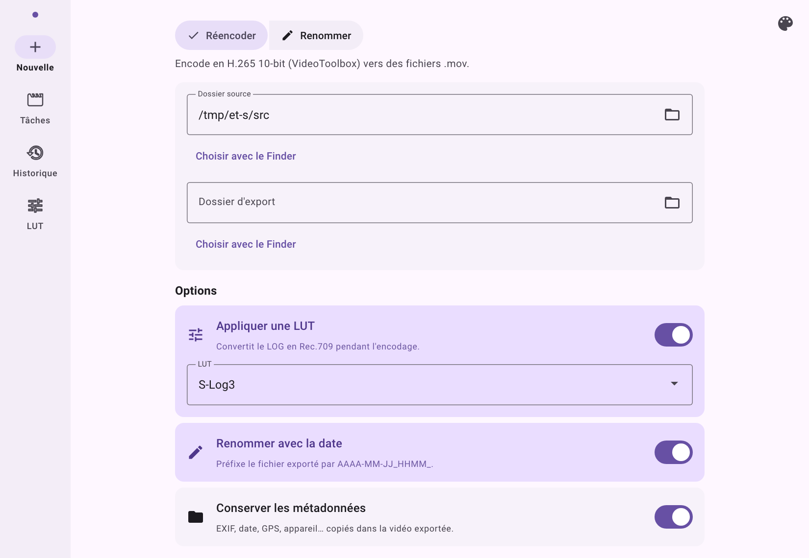
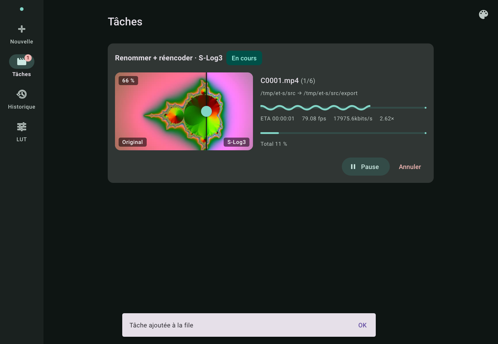

# 🎬 EncodeTool

**EncodeTool** is a local web app to automate batch video processing on macOS: renaming, H.265 10-bit encoding and LUT color grading, with live progress in your browser.

A single Rust binary runs a small server on `127.0.0.1` and serves the web interface (Svelte, Material 3 Expressive design: light/dark theme, navigation rail/bar, expressive motion) embedded in it. Everything stays on your machine: ffmpeg reads and writes your files directly.

## ✨ Features

- **⚡️ H.265 10-bit encoding**: HEVC (Main10) with Apple Silicon hardware acceleration (VideoToolbox), `.mov` output.
- **🎨 3D LUT**: an option of the *Re-encode* task (S-Log2 / S-Log3 / D-Log M or any `.cube`), combinable with *Rename with date* and *Keep metadata*. LUTs are managed from the interface.
- **📅 Smart renaming**: prefixes files with their date (`YYYY-MM-DD_HHMM_`), also available combined with encoding.
- **📊 Live task queue**: per-file and global progress, ETA, FPS, bitrate; video preview of the current file (with a left-to-right before/after wipe when applying a LUT); pause, resume and cancel.
- **🌗 Appearance**: light/dark mode (follows the system by default) and 8 accent colours, remembered in the browser.
- **🏷 Metadata**: EXIF/GPS/date tags are kept by default; one switch strips them from the exported videos.
- **🗂 History** of past tasks (kept between launches) and original creation/modification dates preserved on outputs.
- **📁 Folder selection**: built-in browser, paste/drop a path, or the native macOS dialog.

## 📸 Screenshots

| New task | Live progress (dark, turquoise accent) |
|---|---|
|  |  |

## 🛠 Prerequisites

- macOS (Apple Silicon recommended).
- `ffmpeg` and `ffprobe` with `hevc_videotoolbox` support (`brew install ffmpeg`).
- Build only: Rust (`cargo`) and Node.js.

## 🚀 Build and run

Prebuilt Apple Silicon binaries are attached to each [GitHub release](../../releases) (`tar -xzf encodetool-*.tar.gz`; you may need `xattr -d com.apple.quarantine encodetool` since it is not signed). Or build it yourself:

```bash
./build.sh                    # builds the web UI, then the Rust binary
./target/release/encodetool   # starts the server and opens the browser
```

Options: `--port 7878` (or `ENCODETOOL_PORT`), `--no-open`. Data (history, LUTs) lives in `~/Library/Application Support/EncodeTool` (override with `ENCODETOOL_DATA_DIR`).

## 🧑‍💻 Development

```bash
cargo test                          # backend unit tests
cargo run -- --no-open              # API server on :7878
cd web && npm install && npm run dev  # UI with hot reload (proxies /api to :7878)
```
