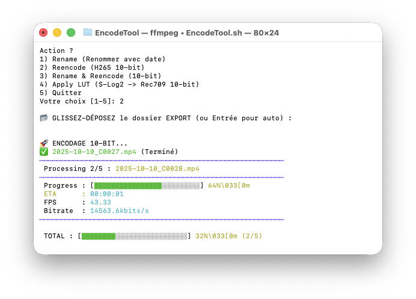
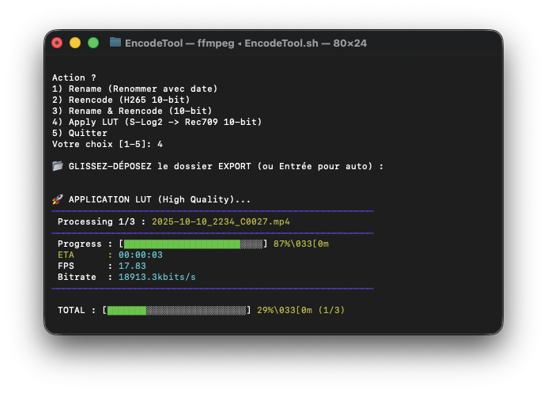

# 🎬 EncodeTool

**EncodeTool** is a blazing fast and aesthetic CLI (Command Line Interface) utility to automate batch video processing on macOS. It is designed to simplify the workflow of content creators by handling renaming, encoding, and color grading in a single command.

<div style="display: flex; justify-content: center; align-items: flex-start; gap: 10px;">
  
  
</div>

## ✨ Features

- **⚡️ H.265 10-bit Encoding**: Mass conversion to HEVC (Main10) codec using Apple Silicon hardware acceleration (VideoToolbox).
- **🎨 3D LUT Application**: Native support for converting LOG profiles (e.g., S-Log2) to Rec.709 directly integrated into the encoding pipeline.
- **📅 Smart Renaming**: Automatically adds the original creation date (metadata) to the filename for perfect chronological sorting.
- **📊 "Premium" UI**:
  - Smooth progress bar for the current file (with ETA, FPS, Bitrate).
  - Persistent global progress bar for batch tracking.
  - Automatic terminal cleanup ("Collapsing" display) for a clean history.

## 🛠 Prerequisites

- macOS (Optimized for Apple Silicon M1/M2/M3).
- `ffmpeg` with `hevc_videotoolbox` support.
- `zsh` (Default shell on macOS).

## ⚙️ Configuration

Before using the **Apply LUT** feature, you **MUST** edit the `EncodeTool.sh` file:

1.  Open `EncodeTool.sh` in a text editor.
2.  Locate the three variables `LUT_SLOG2`, `LUT_SLOG3` and `LUT_DLOGM` (e.g. `LUT_SLOG2="/path/to/your/S-Log2.cube"`).
3.  Replace each placeholder with the absolute path to the matching `.cube` LUT file.

Optionally, set `SOURCE_DIR` / `EXPORT_DIR` to skip the folder prompts.

## 🚀 Usage

1.  Navigate to the script directory:
    ```bash
    cd EncodeTool
    ```
2.  Run the script:
    ```bash
    ./EncodeTool.sh
    ```
3.  Follow the interactive interface:
    - Drag and drop your source folder.
    - Choose an action (Rename, Reencode, Rename & Reencode, Apply LUT for S-Log2 / S-Log3 / DJI D-Log M).
    - Enjoy the magic.
